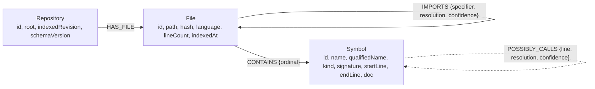
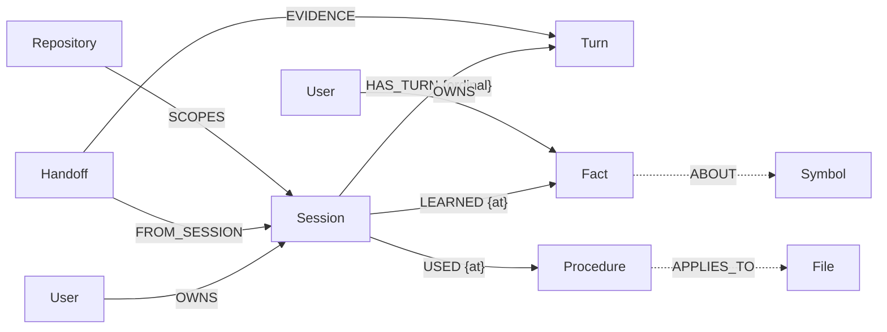

# NEXUS

**A graph-native context layer for coding agents.** A coding agent forgets everything
between sessions, and it finds out what code does by reading files one at a time. NEXUS
gives it both halves of what it is missing: a parsed graph of the repository, and a
memory of what previous sessions learned about it.

Both live in FalkorDB, so both are answered by the same traversal:

- **The code layer** — Repository → File → Symbol, with `IMPORTS` and `POSSIBLY_CALLS`
  edges built from the TypeScript AST and the type checker.
- **The memory layer** — Session → Turn → Fact / Procedure / Handoff, scoped to a user
  and a repository, written by one session and recalled by the next.

It reaches the agent as an MCP server over stdio, so Claude Code, OpenCode, Cursor and
anything else that speaks MCP get the same eight tools. A reference agent is included
that uses nothing but those tools.

This is a submission to **Graph Hacks 2026**.

---

## Why a graph, and not an index file

A symbol table tells you a name exists. A graph tells you what reaches it. Those are
different questions, and only one of them is the one an agent actually asks before it
edits something.

The repository is parsed, not grepped: `ts-morph` produces the symbols, the TypeScript
type checker resolves the calls, and the result is written as nodes and edges. Edges
carry their provenance — `resolved` when the checker confirmed the target, `heuristic`
when only the name matched — and an unresolved reference is stored as a raw string
rather than being guessed into an edge. **No edge in the graph means a fact that was
established, and every edge can say how it was established.**

The memory layer is the other half of the problem. An agent that worked out how a
subsystem fits together on Monday should not have to work it out again on Tuesday.
Facts and procedures are written into the same graph, next to the symbols they are
about, and they are scoped: recall filters on `userId` and `repoId`, so two people
sharing one graph never see each other's notes and two repositories never mix.

---

## Quick start

Requirements: Node 22+, Docker, and a repository to point it at.

```bash
# 1. Build
pnpm install
pnpm build

# 2. Start the graph
docker compose up -d falkordb

# 3. Ask the agent about a repository. Claude is the default, so with a key:
ANTHROPIC_API_KEY=sk-... NEXUS_ROOT=/path/to/some/repo \
  node packages/agent/dist/main.js --symbol normalizeParams

# Without a key, the scripted provider runs the identical tool loop, offline:
NEXUS_ROOT=/path/to/some/repo \
  node packages/agent/dist/main.js --symbol normalizeParams --provider stub
```

That command indexes the repository on its first run, then answers with a cited report:
which symbols call the one you named, which files they are in, how many hops away they
are, and how each edge was resolved. See [the reference agent](#the-reference-agent) for
the other providers and how the scripted one works.

The whole stack in Docker, FalkorDB and agent together:

```bash
NEXUS_REPO=/path/to/some/repo docker compose up agent
```

`NEXUS_REPO` is mounted read-write into the container, because a sync writes one lock
file at `.nexus/sync.lock` to serialise syncs against the same graph. Nothing else in
the repository is touched.

### Wiring it into a client

Copy one file from [`examples/`](examples/) and replace the placeholder paths:

| Client | File | Destination |
| --- | --- | --- |
| OpenCode | [`examples/opencode.json`](examples/opencode.json) | `opencode.json` in the project root |
| Claude Code | [`examples/claude-code.mcp.json`](examples/claude-code.mcp.json) | `.mcp.json` in the project root |
| Cursor | [`examples/cursor.mcp.json`](examples/cursor.mcp.json) | `.cursor/mcp.json` |

Each one runs the same server, pointed at the same graph. Point several clients at one
`FALKORDB_URL` and one `NEXUS_GRAPH` and they share what they learn without knowing about
each other: a note written from OpenCode is recalled from Claude Code.

---

## The eight tools

| Tool | What it answers |
| --- | --- |
| `nexus_sync` | Index or re-index the repository. Incremental after the first run. |
| `nexus_locate` | Which symbols match a name, a signature, or a doc string. |
| `nexus_context` | What a symbol's source is, what it imports, what it calls, what calls it. |
| `nexus_path` | How one symbol reaches another, hop by hop, with each hop's confidence. |
| `nexus_impact` | Who depends on a symbol, nearest first, and which files that touches. |
| `nexus_remember` | Write down a fact or a procedure. |
| `nexus_recall` | Ask what earlier sessions learned. |
| `nexus_handoff` | Summarise this session for whoever picks it up next. |

Every response carries `graphVersion` and `indexedAt`, so an agent can tell whether the
index it is reasoning about is the one on disk. The code tools never write; the memory
tools never touch the code layer except to point a fact at the symbol it is about.

A worked handoff:

```bash
NEXUS_ROOT=/path/to/some/repo node apps/demo/dist/handoff.js write   # session one
NEXUS_ROOT=/path/to/some/repo node apps/demo/dist/handoff.js read    # session two, a new process
```

The first process indexes, records what it found about `normalizeParams`, writes a
procedure for checking a change to it, and hands the session off. The second process, in
a separate run against the same graph, recalls all three — and could not have known any
of it from the repository alone.

---

## The reference agent

`packages/agent` is an agent that uses the MCP server exactly as an outside client does.
It asks the server what tools exist, converts them into model tools, and runs a tool
loop. Nothing about the graph is special-cased for it, which is the point: if the server
is useful to this agent, it is useful to the client you actually use.

The provider is a switch, not a hard dependency. Claude is the default:

| `NEXUS_PROVIDER` | Default model | Key |
| --- | --- | --- |
| `anthropic` (default) | `claude-sonnet-4-5` | `ANTHROPIC_API_KEY` |
| `openai` | `gpt-5.6` | `OPENAI_API_KEY` |
| `google` | `gemini-3.8-flash` | `GOOGLE_GENERATIVE_AI_API_KEY` |
| `ollama` | `qwen3.5:9b` | none, local |
| `openai-compatible` | set `NEXUS_MODEL` | none |
| `stub` | `stub-1` | none, scripted, no network |

A missing key fails at startup and names the variable. There is no silent fallback: an
agent that quietly answered with a different model than the one configured would be
worse than one that refused to start.

The `stub` provider is a scripted `LanguageModelV2`. It turns the whole tool loop into
something a test can assert on — which tool, with which arguments, in which order, and
what the run left in the graph — and it is what the tests, the benchmark, and the demo
use, so any of them is reproducible without a network or a bill.

The agent may also run tests, and it is off unless `NEXUS_ALLOW_TESTS=1` is set exactly.
When it is on, one fixed command is allowed, test files only, repository-relative paths
that must stay inside the root, no shell, and a timeout that kills the child.

---

## The graph model



A symbol's id is a hash of its file, kind, qualified name and occurrence number — and
not its source position. Inserting a line above a symbol therefore does not change its
id, which is what makes an incremental sync an update instead of a rebuild.

`POSSIBLY_CALLS` is named the way it is on purpose. A resolved edge means the type
checker confirmed the target; a heuristic edge means only the name matched, and the
agent is told which is which. Unresolved references produce no edge at all, so the
absence of an edge is never mistaken for the absence of a dependency.

### Memory, and how it attaches to code



Turns are ordered by an `ordinal` property rather than by a `NEXT` chain of edges: a
linked list of turns has to be rewritten every time a turn is appended, and ordering by
a property reaches the same order with one write. Every memory node carries `userId` and
`repoId`, and every memory query filters on both.

Remembrance is not decoration. A recalled fact has its `usedCount` and `lastUsedAt`
updated, so the graph records which of its own memories were actually useful — and the
recall response reports the counts as they stand after the call.

### Indexes

| Target | Index | Serves |
| --- | --- | --- |
| `Repository.id`, `File.id`, `File.path`, `Symbol.id` | range | every traversal |
| `Symbol.name`, `searchText`, `signature`, `doc` | full-text | `nexus_locate` |
| `Fact.text`, `Procedure.name`+`text`, `Handoff.summary` | full-text | `nexus_recall` |
| `Fact.userId`, `Procedure.userId`, `Handoff.userId` | range | per-user isolation |

`searchText` is a camelCase-split copy of the symbol name, so `nexus_locate
"normalize params"` and `nexus_locate normalizeParams` find the same symbol. Search
terms are OR-ed and ranked by score, and the match is reported, so a result can be
trusted or discarded rather than just believed.

---

## The queries behind the tools

The interesting parts are all Cypher. These are the real queries the server runs.

**Search** — full-text, scoped by repository, ranked:

```cypher
CALL db.idx.fulltext.queryNodes('Symbol', $query) YIELD node, score
MATCH (f:File)-[:CONTAINS]->(node)
MATCH (:Repository {id: $repoId})-[:HAS_FILE]->(f)
RETURN node.id AS symbolId, ..., score
ORDER BY score DESC, qualifiedName ASC
LIMIT $limit
```

**Change impact** — every path from a possible caller down to the symbol, both
confidences and the path itself, so the shortest can be chosen:

```cypher
MATCH (:Repository {id: $repoId})-[:HAS_FILE]->(:File)-[:CONTAINS]->(s:Symbol {id: $symbolId})
MATCH p = (caller:Symbol)-[:POSSIBLY_CALLS*1..4]->(s)
MATCH (g:File)-[:CONTAINS]->(caller)
RETURN caller.id AS symbolId, ..., [n IN nodes(p) | n.qualifiedName] AS names,
       [r IN relationships(p) | r.confidence] AS confidences,
       [r IN relationships(p) | r.resolution] AS resolutions
LIMIT 5000
```

The variable-length match is what makes this a graph question. Each returned path is
reduced to the shortest one to each caller, and its confidence is the product of its
edge confidences — so a two-hop answer through a heuristic edge is never presented as
certain. `via` names the symbol the caller actually calls, so an agent can tell a direct
caller from an indirect one.

**Call paths** — FalkorDB's `algo.SPpaths`, with the direction chosen by the caller:

```cypher
CALL algo.SPpaths({
  sourceNode: s,
  targetNode: t,
  relTypes: ['POSSIBLY_CALLS'],
  relDirection: 'outgoing',
  maxLen: $maxDepth,
  pathCount: $maxPaths
})
YIELD path
RETURN [n IN nodes(path) | n.id] AS ids,
       [r IN relationships(path) | startNode(r).id] AS sources,
       [r IN relationships(path) | r.resolution] AS resolutions,
       [r IN relationships(path) | r.confidence] AS confidences
```

Each hop is labelled `outgoing` or `incoming` by comparing `startNode(r)` with the hop's
own starting symbol, so an answer can mix "calls into" and "is called by" rather than
confusing the two.

**Multi-hop context** — depth 2 walks through one intermediate symbol, which is how a
symbol that is called by a symbol that is called by the target still shows up:

```cypher
MATCH (:Repository {id: $repoId})-[:HAS_FILE]->(:File)-[:CONTAINS]->(s:Symbol {id: $symbolId})
MATCH (t:Symbol)-[c2:POSSIBLY_CALLS]->(m:Symbol)-[c1:POSSIBLY_CALLS]->(s)
WHERE t.id <> s.id AND m.id <> s.id
RETURN t.id AS symbolId, m.qualifiedName AS via, ...
```

**Recall** — full-text over the user's own facts, procedures and handoffs:

```cypher
CALL db.idx.fulltext.queryNodes('Fact', $query) YIELD node AS f, score
MATCH (s:Session)-[:LEARNED]->(f)
WHERE f.userId = $userId AND f.repoId = $repoId
RETURN f.id AS factId, f.text AS text, score AS score
ORDER BY score DESC
LIMIT $limit
```

FalkorDB requires an `ORDER BY` expression to be projected, which is why `score AS score`
appears in the `RETURN` of every ranked query.

Two more that are worth reading the source for: writes use relationship `MERGE` and
single-query session counters, so re-running a write is idempotent and two clients
writing at once cannot lose a turn; and an optional edge is created with
`OPTIONAL MATCH ... FOREACH (_ IN CASE WHEN x IS NULL THEN [] ELSE [1] END | MERGE ...)`,
which is the only way to conditionally create an edge in one round trip.

---

## Incremental sync

A sync is a diff against the graph, not a rebuild.

1. Walk the repository, hash every file, and compare with the `File` nodes.
2. Nothing changed? Return without touching the analyzer. On a 522-file repository this
   is about 0.2 s.
3. Otherwise, re-analyze the changed files, recompute the calls that a change can
   affect, and rewrite only those symbols and edges.
4. Files deleted from disk are deleted from the graph along with their symbols, and
   their dependents are rewritten.
5. The repository's `graphVersion` bumps. Memory writes carry their own timestamps and
   deliberately do not bump it: the version describes the code index, not the graph.

Two properties that took work:

- **Per-file isolation.** A file either indexes completely or is left entirely
  untouched and retried next sync. One unparseable file cannot leave the graph
  half-written, and one bad file cannot abort a sync of 500 good ones. Zod's
  `.claude/skills/triage/scripts/reindex.mjs` produces three unresolved calls on every
  sync, which is exactly the case this handles.
- **A repository lock.** `.nexus/sync.lock` holds the owning PID. A live owner blocks a
  competing sync; a stale lock is replaced. Two MCP clients starting at once do not
  interleave writes.

The analyzer is kept warm across syncs, which is where most of the speed comes from —
but it is not free, and the cost is stated plainly below rather than hidden.

**What gets indexed.** `.gitignore` is respected, along with a default list of build and
vendor directories (`.git`, `.nexus`, `node_modules`, `dist`, `build`, `coverage`,
`vendor`, `out`, `.next`, `.turbo`), and `.env`-shaped files and key material are skipped
outright so that secrets cannot reach the graph. Anything else is added to `.nexusignore`
in the repository root. Hidden directories are **not** excluded wholesale: `.claude/` or
`.github/` often hold real scripts, and excluding them by default would silently hide code
from the impact analysis rather than from the graph alone.

---

## What it costs, and what it removes

The honest version. Indexing a repository is expensive and happens up front:

| | 522-file TypeScript repository |
| --- | --- |
| Cold index | ~30 s |
| No-op sync | ~0.2 s |
| Located symbols | 14,162 |
| Resolved call edges | 5,184 |
| Resolved import edges | 647 |

Then every question it answers costs a query instead of a pile of file reads. From
[`bench/`](bench/), three tasks, each run twice: once with the Nexus tools, once with
only the filesystem tools an agent would otherwise use. The model is the scripted stub in
**both** conditions, so what the numbers compare is the work the tools require — not one
model's cleverness against another's.

| Task | Tools | Calls | Files mentioning the name | Files opened | Bytes from disk | Tokens returned | Wall clock |
| --- | --- | --- | --- | --- | --- | --- | --- |
| Which symbols call `normalizeParams`? | nexus | 2 | 4 | 0 | 0 | 1,165 | 47 ms |
| | filesystem | 5 | 4 | 4 | 274,402 | 23,568 | 151 ms |
| Where is `ZodError` defined? | nexus | 2 | 145 | 0 | 0 | 834 | 44 ms |
| | filesystem | 26 | 145 | 25 | 156,216 | 60,217 | 159 ms |
| What did earlier sessions learn about `normalizeParams`? | nexus | 1 | 4 | 0 | 0 | 228 | 22 ms |
| | filesystem | 5 | 4 | 4 | 274,402 | 23,568 | 140 ms |

Read the third task carefully, because it is the one that is not a cost comparison. No
amount of reading source code recovers what a previous session concluded about it; the
baseline reads 274 KB and
[reaches the same place it started](bench/src/tasks.ts). The graph answers it in 228
tokens, because the conclusion was written down when it was reached.

Two things the table does not say, and both matter:

1. **The baseline is the honest minimum, not a straw man.** It reads every file that
   mentions the name, because a mention is not a call and each candidate has to be
   judged. It is capped at 25 files — not to weaken it, but because 145 files of
   candidates exceed what fits in a context window at all. The cap is stated in the
   results.
2. **The cold index is the bill for all of it.** The graph cannot be queried until it has
   been built. It is paid once per repository and re-paid incrementally, rather than once
   per question, which is what makes the trade worth it for a repository an agent will
   touch more than a few times.

Run it yourself against any repository — raw JSON lands in `bench/results/`:

```bash
node bench/dist/run.js --root /path/to/repo --runs 2
```

---

## Repository layout

```
packages/core        graph client, schema, ids, code and memory stores
packages/parser-ts   ts-morph extraction: symbols, imports, calls
packages/indexer     repository walk, hashes, incremental sync, lock
packages/mcp         the MCP server and its eight tools
packages/agent       the reference agent, provider switch, scripted model
apps/demo            the two-process handoff demo
bench                the benchmark and its results
examples             client configs for OpenCode, Claude Code, Cursor
docs                 graph model, build log, and the demo script
```

---

## Development

```bash
pnpm typecheck   # tsc -b across the workspace
pnpm lint        # eslint
pnpm test        # vitest, against a live FalkorDB
pnpm build
```

174 tests across 18 files. Most of them run against a real FalkorDB, because the parts
worth testing are the Cypher and the graph behaviour, and a mock would test the mock. The
suite covers the parser against real TypeScript, sync idempotence and per-file isolation,
the two-connection handoff (two independent clients against one graph, which is the whole
of Track 02), the MCP contract over an in-memory transport, and the agent end to end
through the real server.

The test runner the agent may reach is itself tested for its refusals: absolute paths,
traversal, non-test files, null bytes, and runs that overrun their timeout.

---

## Track declaration

**Track 01 (primary) — Agents That Act on Connected Data.** The agent acts on the graph:
it walks `POSSIBLY_CALLS` backwards to map change impact, uses `algo.SPpaths` to trace
call paths, and reads a symbol's context from its neighbours. FalkorDB is not storage
behind the product; it is where the product's questions are asked.

**Track 02 (secondary) — Agent Memory and Coordination.** A session writes facts,
procedures and a handoff into the graph. A later session, in a different process and a
different run, recalls them. The gate is
[`apps/demo/src/handoff.ts`](apps/demo/src/handoff.ts): two processes, no shared memory,
one graph — and the second process proves it learned something the repository alone could
not have told it. `bench/`'s third task measures the same thing from the other direction,
as the cost of *not* having it.

Both tracks share one graph rather than being two features side by side: memory attaches
to code through `ABOUT` and `APPLIES_TO`, so a recalled fact points at the symbol it was
learned about.

The [demo script](docs/demo-script.md) is the shot-by-shot version of both, with the
command and the output to expect for each one.

---

## Use of AI

Claude via OpenCode was used throughout the build, for code, tests, documentation, and
review, and the benchmark's `stub` provider is a scripted model rather than a live one.
Every change was run through typecheck, lint and tests before it was committed, each
milestone is its own commit, and the build log in [`docs/dev-log.md`](docs/dev-log.md)
records what was measured and what went wrong, including the estimates that turned out to
be wrong.

---

## License

MIT.
