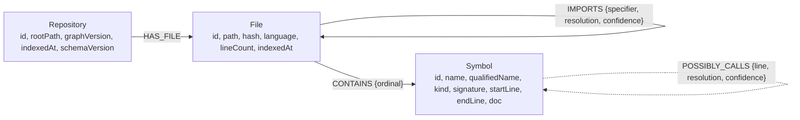
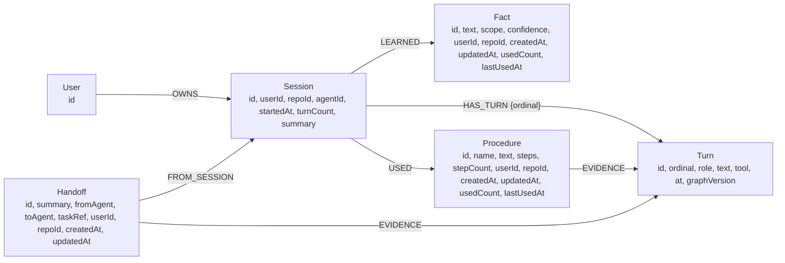
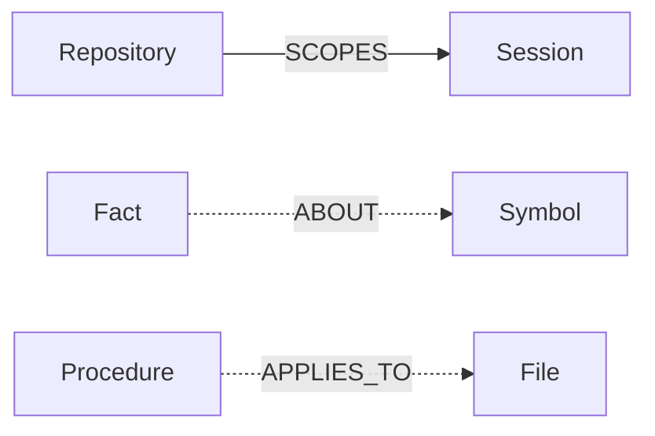

# The NEXUS graph model

This is the reference for what is in the graph. Everything marked **implemented** is in
the code and covered by tests; everything marked **planned** is not, and is listed so the
gap is visible rather than implied.

Edges that come from parsing are drawn solid. Inferred edges carry `resolution` and
`confidence` and are drawn dashed.

## Code layer

`resolution` is one of:

- `resolved` — the TypeScript type checker confirmed the target.
- `heuristic` — the name matched and nothing contradicted it. Only emitted for member
  calls whose method name is unique in the repository.

Anything the parser could not resolve is stored as a raw string property on the caller
and produces **no edge**. An absent edge is therefore a missing fact, never a negative
one, and the tools say so: `nexus_impact` returns paths, not proofs, and every hop
carries its confidence.

A symbol's id is `sha256(fileId, kind, qualifiedName, occurrence)` — deliberately not
including a source offset, so inserting lines above a symbol leaves its id unchanged and
an incremental sync updates the graph instead of rebuilding it.

## Memory layer

Turns are ordered by the `ordinal` property, not by a chain of edges. A linked list of
`NEXT` edges would have to be rewritten every time a turn is appended — the tail's edge
would have to move — whereas `ordinal` is computed once by a single-query counter
(`SET s.turnCount = coalesce(s.turnCount, 0) + 1`) and read back with an `ORDER BY`.
The `NEXT` edge was dropped for that reason.

Every memory node carries `userId` and `repoId`, and **every** memory query filters on
both. Memory is not a shared pool with a filter over it; it is a pool that cannot be
read across users even by a malformed query, because the scope predicate is part of every
query that reads memory.

Recall is not passive. `nexus_recall` raises `usedCount` and sets `lastUsedAt` on the
facts and procedures it surfaces, and the response reports the counts **after** the call,
so the number in the reply and the number in the graph agree. That is what makes "which
of its own memories were actually useful" answerable.

## Links between the layers

These three edges are what make the two layers one graph rather than two features sharing
a database. A fact can point at the symbol it was learned about, and a procedure at the
file it applies to — so "what is known about this symbol" is a traversal from code to
memory, in the same query planner as everything else.

## What is not implemented

Listed because the alternative is a diagram that lies.

- `Turn -[:QUERIED {tool, args}]-> Symbol` and `Turn -[:TOUCHES]-> File`. The data
  exists: every turn records the tool that produced it and the `graphVersion` it was
  taken against. Turning those into edges would let the graph answer "which sessions
  looked at this symbol", which is a genuinely useful question and is the next thing to
  build. Today, that provenance stops at the turn's text.
- `LEFT_OFF`, an edge from a handoff to the exact place work stopped. A handoff
  summarises the session and attaches its evidence turns; it does not yet point at a
  position in a file.
- Vectors. Search is full-text only. Embeddings were the first thing cut, on the grounds
  that a graph that is accurate about structure is worth more than one that is
  approximately similar about meaning.

## Indexes

Created on first use, idempotently.

| Target | Index | Serves |
| --- | --- | --- |
| `Repository.id`, `File.id`, `File.path`, `Symbol.id` | range | every traversal |
| `User.id`, `Session.id`, `Turn.id`, `Fact.id`, `Procedure.id`, `Handoff.id` | range | id lookup |
| `Symbol.name`, `Symbol.searchText`, `Symbol.signature`, `Symbol.doc` | full-text | `nexus_locate` |
| `Fact.text` | full-text | `nexus_recall` |
| `Procedure.name`, `Procedure.text` | full-text | `nexus_recall` |
| `Handoff.summary` | full-text | `nexus_recall` |
| `Fact.userId`, `Procedure.userId`, `Handoff.userId` | range | per-user isolation |

`Symbol.searchText` is a camelCase-split copy of the name, so `"normalize params"` and
`"normalizeParams"` reach the same symbol. Full-text from FalkorDB's `db.idx.fulltext`,
with an explicit index — not a `CONTAINS` scan, which would be a trap at 14,000 symbols.

Full-text has one FalkorDB wrinkle worth recording: an `ORDER BY` expression has to be
projected, so every ranked query returns `score AS score` and orders by it.

## Sizes

Measured on a 522-file TypeScript repository (zod): 14,162 symbols, 5,184 resolved call
edges, 647 resolved import edges. A cold index takes about 30 s; a sync that finds
nothing changed takes about 0.2 s.
