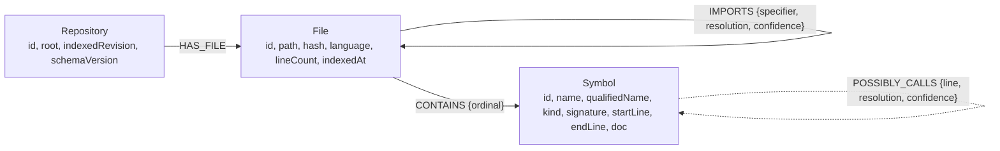
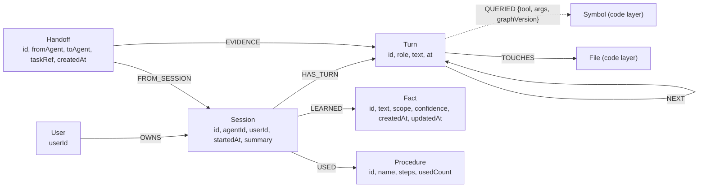
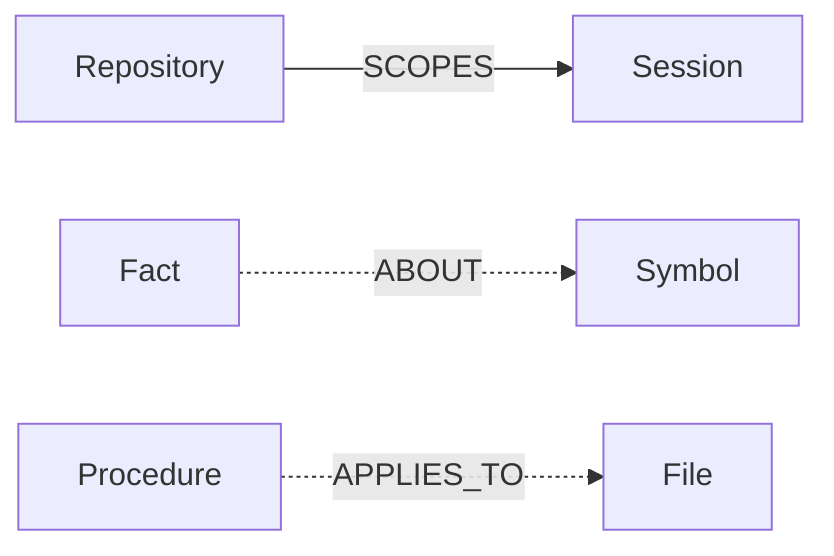

# NEXUS graph model (sketch)

Status: schema diagram. This file is the reference for the graph model.

Edges that come from parsing are solid. Inferred edges carry `resolution` and `confidence` and are drawn dashed.

## Code layer

Resolution values for `IMPORTS` and `POSSIBLY_CALLS`:
- `resolved`: the type checker confirmed the target.
- `heuristic`: matched by name only.
- Unresolved references are stored as raw names on the caller and get no edge.

## Memory layer (Track 02)

## Links between the layers

Every memory node carries `userId` and `repoId`. Every memory query filters on both.

## Indexes

| Target | Index | Used by |
|---|---|---|
| `File.path`, `Symbol.id` | range (unique lookup) | all traversals |
| `Symbol.name`, `Symbol.signature`, `Symbol.doc` | full-text | `nexus_locate` |
| `Fact.text`, `Turn.text` | full-text | `nexus_recall` |
| `Session.userId`, `Fact.userId`, `Turn.userId` | range | per-user isolation |

Vectors are deferred (first to be cut).
